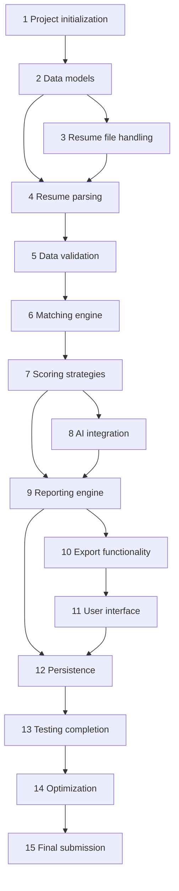

# IMPLEMENTATION_PLAN.md — Phased Development Roadmap

Related: [PROJECT_REQUIREMENTS](PROJECT_REQUIREMENTS.md) · [SYSTEM_ARCHITECTURE](SYSTEM_ARCHITECTURE.md) · [TECHNICAL_SPECIFICATION](TECHNICAL_SPECIFICATION.md) · [TESTING_STRATEGY](TESTING_STRATEGY.md) · [DEVELOPMENT_RULES](DEVELOPMENT_RULES.md)

> The plan describes work **to be done**. A phase is complete only when its completion criteria have been **verified by running the stated commands**.
> Effort sizes are relative (S ≈ small, M ≈ medium, L ≈ large), not time estimates.

---

## 1. How to use this plan

1. Execute phases in order; a phase may start when its **dependencies** are complete.
2. **Tests are written in the same phase as the code they cover** (not postponed to Phase 13). Phase 13 completes cross-cutting integration, evaluation, and coverage gaps.
3. At the end of every phase: run the **phase gate** below, update documentation touched by the phase, and tick the corresponding items in [SUBMISSION_CHECKLIST](SUBMISSION_CHECKLIST.md) **only with evidence**.
4. Before creating or deleting any file, inspect the repository (rule DR-REPO-1).

**Phase gate (run at the end of every phase):**

```bash
ruff check src tests && black --check src tests
pytest -q                       # all tests so far must pass
bandit -q -r src                # no unresolved findings
git status                      # review exactly what changed
```

## 2. Phase dependency graph



## 3. Phase summary

| # | Phase | Size | Main requirements | Primary packages |
|---|---|---|---|---|
| 1 | Project initialization | M | NFR-01, NFR-02, NFR-04, NFR-07, NFR-12 | repo root, `config`, `exceptions`, `logging_setup` |
| 2 | Data models | M | FR-04–FR-09, FR-22 (types) | `models` |
| 3 | Resume file handling | M | FR-01, FR-02, NFR-10 | `ingestion` |
| 4 | Resume parsing | L | FR-03–FR-08, NFR-03, NFR-09, NFR-14 | `skills`, `parsing` |
| 5 | Data validation | S | FR-08, FR-09, NFR-05 | `validation` |
| 6 | Matching engine | M | FR-10–FR-12 | `matching` |
| 7 | Scoring strategies | M | FR-13–FR-16 | `scoring` |
| 8 | AI integration | L | FR-17–FR-21, FR-32, NFR-11, NFR-13, NFR-18 | `ai` |
| 9 | Reporting engine | M | FR-22, FR-23, NFR-15 | `reporting`, `services` |
| 10 | Export functionality | M | FR-24–FR-26 | `reporting.exporters` |
| 11 | User interface | L | FR-30, FR-31, FR-15 | `ui`, `cli`, `services` |
| 12 | Persistence | M | FR-27–FR-29, NFR-19 | `storage` |
| 13 | Testing | M | NFR-08, M-01–M-06 | `tests/` |
| 14 | Optimization | S | NFR-09, NFR-16 | cross-cutting |
| 15 | Final submission | S | NFR-17, all | repo, docs |

---

## Phase 1 — Project initialization

**Objectives:** a runnable, lint-clean, test-capable skeleton with configuration, logging, and exceptions in place.

**Tasks**
1. Inspect the target workspace; create the repository layout from [PROJECT_STRUCTURE](PROJECT_STRUCTURE.md) (only directories needed now; empty packages with `__init__.py`).
2. Create `pyproject.toml` (package metadata, `src/` layout, tool config for `ruff`, `black`, `pytest`, `bandit`, `radon`), `requirements.txt`, `requirements-dev.txt`, `.gitignore`, `.env.example`, `.streamlit/config.toml`.
3. Implement `exceptions.py` (full hierarchy and error codes, [TECHNICAL_SPECIFICATION §13](TECHNICAL_SPECIFICATION.md)).
4. Implement `config/settings.py` (pydantic `Settings`, YAML loader, env overrides, `lru_cache`) and `config/config.yaml` per [CONFIGURATION_AND_SECURITY §3](CONFIGURATION_AND_SECURITY.md).
5. Implement `logging_setup.py` (levels, rotating file, `PIIMaskingFilter`).
6. Add `tests/conftest.py` (cache-clearing fixtures, temp dirs, `reference_date` fixture).

**Dependencies:** none.

**Deliverables:** installable package; `config.yaml`; exceptions; logging; first unit tests (UT-CFG-*, UT-LOG-*, UT-EXC-*, UT-CACHE-01).

**Completion criteria**
- `pip install -e .` succeeds; `python -c "import resume_analyzer"` works.
- Phase gate commands pass.
- Invalid weights in config raise `ConfigurationError` (UT-CFG-02).
- PII filter masks e-mails in log records (UT-LOG-01).

## Phase 2 — Data models

**Objectives:** typed, validated models and enums exactly as specified.

**Tasks**
1. Implement `models/enums.py`, `candidate.py`, `job.py`, `results.py` ([TECHNICAL_SPECIFICATION §4](TECHNICAL_SPECIFICATION.md)); `extra="forbid"`.
2. Job validators (dedupe, bounds, required ≥ 1) collecting all problems.
3. JSON round-trip helpers (use pydantic `model_dump_json` / `model_validate_json`).
4. Create `samples/jobs/*.json` (≥ 3 synthetic jobs).

**Dependencies:** Phase 1.

**Deliverables:** `models/` package; sample jobs; tests UT-VAL-01..03 (model-level), model round-trip tests.

**Completion criteria:** every model instantiates, serializes, and re-validates; forbidden fields (DOB, gender, etc.) do **not** exist on `Candidate`; tests pass.

## Phase 3 — Resume file handling

**Objectives:** safe ingestion of PDF, DOCX, TXT into raw text.

**Tasks**
1. `ingestion/file_validator.py` (`validate_upload`): extension, size, magic bytes, emptiness, encryption, DOCX archive limits, macro rejection.
2. `ingestion/text_extractors.py`: PDF (`pdfplumber` + `pypdf` fallback), DOCX (paragraphs + tables), TXT (encoding fallback).
3. `ingestion/file_loader.py` (`load_resume`): composes validation + extraction + length limits; no disk writes.
4. Create synthetic fixtures in `tests/data/resumes/`: valid TXT/DOCX/PDF, empty, oversize, corrupt, encrypted PDF, renamed-extension, zip-bomb-like DOCX (generated in test code, never committed as a real bomb).
5. Never log original filenames; use `safe_display_name`.

**Dependencies:** Phase 2 (models), Phase 1.

**Deliverables:** `ingestion/` package; fixtures; tests UT-FILE-01..11.

**Completion criteria:** each failure scenario raises its specific exception with the documented code and `user_message`; scanned-PDF fixture raises `EmptyResumeError`; no file is written during load (asserted).

## Phase 4 — Resume parsing

**Objectives:** deterministic extraction of name, e-mail, skills, experience, education from text.

**Tasks**
1. `skills/taxonomy.py`, `skills/normalizer.py`, `skills/skill_index.py`; author `config/skills_taxonomy.json` (≥ 300 curated skills with aliases, categories, confusable pairs; record data sources and licences in a header comment field `"sources"`).
2. `parsing/text_cleaner.py`, `section_splitter.py`, `contact_extractor.py`, `skills_extractor.py`, `experience_parser.py`, `education_parser.py`, `pii.py` (mask + injection scanner).
3. `parsing/resume_parser.py` (`ResumeParser.parse`) assembling `Candidate`, warnings, `candidate_id`.
4. Apply `lru_cache` to `normalize_skill`, `fuzzy_similarity`, taxonomy loader (clear in tests).
5. Create ≥ 15 synthetic resumes (varied layouts/sections) with gold annotations in `tests/data/gold/*.json` (skills, name, email, total years, highest education).

**Dependencies:** Phases 2 and 3.

**Deliverables:** `skills/`, `parsing/`; taxonomy JSON; gold dataset v1; tests UT-CLEAN-*, UT-CONT-*, UT-SKILL-*, UT-EXP-*, UT-EDU-*, UT-PARSE-*, UT-CACHE-*.

**Completion criteria:** parser never raises on missing sections; no-fabrication test passes (UT-PARSE-05); protected attributes are not extracted (UT-PARSE-06); first extraction-accuracy run (ET-01) executes and **its real result is recorded** (even if poor).

## Phase 5 — Data validation

**Objectives:** central validation of job and candidate data with clear, collected error messages and parse-quality warnings.

**Tasks**
1. `validation/validators.py`: `validate_job`, `validate_candidate`, `assess_parse_quality`.
2. Wire warning codes ([TECHNICAL_SPECIFICATION §6.8](TECHNICAL_SPECIFICATION.md)).
3. Messages must not echo resume content.

**Dependencies:** Phases 2, 4.

**Deliverables:** `validation/`; tests UT-VAL-01..06.

**Completion criteria:** a job with three different problems yields one `DataValidationError` listing all three; parse-quality warnings appear for the "sparse resume" fixture.

## Phase 6 — Matching engine

**Objectives:** exact/alias/fuzzy skill matching and experience/education evaluation per spec.

**Tasks**
1. `matching/skill_matcher.py` (§7.2), including the rule that fuzzy matching applies only when at least one side is outside the taxonomy, length and first-character guards, confusable pairs.
2. `matching/experience_evaluator.py`, `education_evaluator.py` (§7.3, §7.4).
3. `matching/matching_engine.py` (`MatchingEngine.match`).
4. Skill-index performance sanity check (build once, reuse).

**Dependencies:** Phases 4, 5.

**Deliverables:** `matching/`; tests UT-MATCH-01..07, UT-EXPEV-01..04, UT-EDUEV-01..04.

**Completion criteria:** worked example in TECHNICAL_SPECIFICATION §7.5 reproduces `required_credit ≈ 0.7818`; `java`≠`javascript`; one `SkillMatch` per job skill.

## Phase 7 — Scoring strategies

**Objectives:** Strategy pattern with basic and weighted scoring, fit bands, flags.

**Tasks**
1. `scoring/base.py` (ABC), `basic.py`, `weighted.py`, `registry.py`, `bands.py`.
2. Weight validation (sum = 1.0), `unknown_policy`, renormalization, `coverage`, flags (`INCOMPLETE_DATA`, `MISSING_REQUIRED_SKILLS`, `UNKNOWN_TREATED_AS_ZERO`).
3. Rounding rule (1 decimal; band on rounded score).
4. Property-style tests: score in [0,100]; monotonicity (adding a matched required skill never lowers the score); determinism.

**Dependencies:** Phase 6.

**Deliverables:** `scoring/`; tests UT-SCORE-01..10.

**Completion criteria:** worked example yields **78.2** (basic) and **79.1** (weighted); switching strategy requires no code change outside the registry; unknown strategy raises `UnknownStrategyError`.

## Phase 8 — AI integration

**Objectives:** provider-agnostic AI layer implementing P1–P5 with validation, grounding, sanitization, and graceful degradation.

**Tasks**
1. `ai/provider_base.py` (`LLMProvider` protocol), `providers/null.py`, `providers/gemini.py`, `providers/ollama.py`, `providers/openai_compatible.py`, `provider_factory.py` (keys from environment only).
2. `ai/sanitizer.py` (sanitize, delimiter neutralization), scanner in `parsing/pii.py` reused; `ai/grounding.py`; `ai/json_utils.py`; `ai/rate_limiter.py`.
3. `ai/schemas.py` (pydantic models for all outputs and fact builders); `ai/prompt_registry.py` + `ai/prompt_templates/*.j2` copied **verbatim** from [AI_PROMPTS](AI_PROMPTS.md).
4. `ai/ai_service.py` with the five methods; retry/backoff; one repair retry; `FeatureResult` mapping; P1 merge rules in `services`.
5. `FakeProvider` in `tests/` returning golden valid/invalid/malicious responses.
6. Manual live smoke test with one provider (Gemini free tier **if available**, otherwise Ollama); record outcomes in the prompt change log.

**Dependencies:** Phase 7 (facts come from deterministic results), Phase 4 (parsing for P1 merge).

**Deliverables:** `ai/` package; templates; tests UT-AI-01..13; ET-03 injection suite.

**Completion criteria:** with `NullProvider` every feature returns `DISABLED` and the pipeline is unaffected; with `FakeProvider` golden responses all five features return `OK`; malformed/malicious fake responses never crash and never alter scores; no prompt/response text appears in logs (UT-LOG-03).

## Phase 9 — Reporting engine

**Objectives:** build complete `AnalysisReport` objects with provenance and flags; assemble the end-to-end `AnalysisService`.

**Tasks**
1. `reporting/report_builder.py`, `reporting/provenance.py` (labels, display names, fixed notices).
2. `services/analysis_service.py` implementing the pipeline ([SYSTEM_ARCHITECTURE §5](SYSTEM_ARCHITECTURE.md)); `AnalysisOptions`; deterministic path works with no AI.
3. Report flags and `config_snapshot`.
4. `services/batch_runner.py` skeleton (completed in Phase 11).

**Dependencies:** Phases 7, 8.

**Deliverables:** `reporting/` (builder), `services/analysis_service.py`; tests UT-REP-01..05, IT-01..03.

**Completion criteria:** running the service on each sample resume with AI off and with `FakeProvider` produces valid `AnalysisReport`s; human-review notice present; AI-failure scenario still yields a report.

## Phase 10 — Export functionality

**Objectives:** HTML, PDF, Excel exports from `AnalysisReport`, plus batch ranking workbook.

**Tasks**
1. `reporting/exporters/base.py` (ABC, registry), `html_exporter.py` + `templates/report.html.j2`, `pdf_exporter.py` (+ bundled Unicode font and licence), `excel_exporter.py`.
2. Escaping/injection defences (HTML autoescape, reportlab escape, Excel formula prefixing).
3. Atomic writes; `ExportError` mapping.

**Dependencies:** Phase 9.

**Deliverables:** exporters; tests UT-XPT-01..07, IT-05.

**Completion criteria:** all three formats generated for every sample report; tests re-open each file (HTML parse, PDF page count/text via `pypdf`, Excel via `openpyxl`) and assert sections and values; malicious resume strings (`<script>`, `=HYPERLINK(...)`) are inert in outputs.

## Phase 11 — User interface

**Objectives:** Streamlit UI and CLI over the services; batch processing with progress.

**Tasks**
1. `services/batch_runner.py` complete: per-file isolation, progress callback, ranking.
2. `ui/streamlit_app.py`, `ui/components.py`, `ui/state.py`: pages Job, Resumes, Results, Reports, History (history wired in Phase 12); strategy selector; AI toggles; provenance badges; error display via `user_message`.
3. `cli.py` commands `analyze`, `batch` (tqdm), `benchmark`; `list/export/purge/feedback-summary` completed in Phase 12.
4. UI help text includes scoring limitations (§7.7).

**Dependencies:** Phases 9, 10.

**Deliverables:** `ui/`, `cli.py`, `services/batch_runner.py`; tests UT-BATCH-01..03 (isolation, ordering, progress), IT-04, IT-06 (`streamlit.testing.v1.AppTest` smoke).

**Completion criteria:** from a clean install a reviewer can complete workflow W-1 and W-2 ([PROJECT_REQUIREMENTS §5](PROJECT_REQUIREMENTS.md)); a corrupt file in a batch is reported and does not stop the batch; UI shows the progress indicator.

## Phase 12 — Persistence

**Objectives:** JSON persistence, history, deletion, retention, feedback.

**Tasks**
1. `storage/paths.py` (`safe_join`, id regex), `result_store.py`, `feedback_store.py`.
2. UI **History** page and **Feedback** widgets; CLI `list`, `export`, `purge`, `feedback-summary`.
3. `scripts/summarize_feedback.py` (thin wrapper over `FeedbackStore.summarize`).
4. Retention: `purge_older_than`; UI "Delete this analysis" and "Delete all data".

**Dependencies:** Phases 9, 11.

**Deliverables:** `storage/`; tests UT-STORE-01..08, UT-FB-01..03, IT-07, IT-08.

**Completion criteria:** save→load round trip equals original; interrupted write leaves previous file intact (simulated); invalid ids/path traversal rejected; corrupt JSON handled without crashing the History page.

## Phase 13 — Testing (completion and evaluation)

**Objectives:** close coverage gaps; run evaluation procedures; record honest metrics.

**Tasks**
1. Run `pytest --cov=src/resume_analyzer --cov-report=term-missing`; add tests until the **target** ≥ 80 % for core packages (parsing, matching, scoring, ai, storage, reporting) is met or deviations are justified.
2. Build the labelled evaluation datasets ([TESTING_STRATEGY §8](TESTING_STRATEGY.md)): ≥ 30 synthetic resumes with gold skills; matching-label set (resume × job) annotated by ≥ 2 people if possible.
3. Execute ET-01 (extraction accuracy), ET-02 (precision/recall + threshold sweep), ET-04 (speed), ET-05 (maintainability), ET-06 (feedback summary).
4. Write results to `tests/evaluation/results/<date>_*.md` — **actual numbers only**, with dataset size, hardware, and caveats.
5. Re-run the injection suite ET-03 after any prompt change.

**Dependencies:** Phases 1–12.

**Deliverables:** complete test suite; evaluation reports; coverage report.

**Completion criteria:** full `pytest` passes; every requirement in the traceability matrix ([TESTING_STRATEGY §10](TESTING_STRATEGY.md)) has ≥ 1 passing test; evaluation reports exist for M-01…M-06 (or an explicit explanation why a metric could not be measured).

## Phase 14 — Optimization

**Objectives:** remove measured bottlenecks; improve maintainability. **Optimize only what was measured.**

**Tasks**
1. Profile the deterministic pipeline (`cProfile` on the benchmark corpus); address top hot spots (e.g., regex precompilation, avoiding repeated normalization, PDF page limits).
2. Confirm `SkillIndex` is built once and reused; verify cache hit rates via `cache_info()`.
3. Optional: `ProcessPoolExecutor` for parsing in `batch` (`batch.max_workers`), keeping AI calls rate-limited.
4. Reduce complexity: run `radon cc -s -a src` and refactor functions above rank B (complexity > 10) where practical.
5. Re-run benchmark and record before/after numbers honestly.

**Dependencies:** Phase 13.

**Deliverables:** optimized code; before/after benchmark notes; complexity report.

**Completion criteria:** no behavioural regressions (all tests pass); benchmark and complexity reports updated.

## Phase 15 — Final submission

**Objectives:** verified, documented, reproducible deliverable.

**Tasks**
1. Walk every item of [SUBMISSION_CHECKLIST](SUBMISSION_CHECKLIST.md); attach evidence (command output summaries, report paths).
2. Fresh-clone test: clone, create venv, install, run tests, launch UI, run a sample analysis with AI off.
3. `grep -rn "TODO\|FIXME" src tests` returns nothing.
4. Synchronize `README.md`, `PROJECT_STRUCTURE.md`, config documentation, and prompt change log with the code.
5. Generate sample outputs (from synthetic data) in `samples/outputs/`.
6. Tag the release (`v1.0.0`) and write a short `CHANGELOG` section inside README (no new files unless justified).

**Dependencies:** Phase 14.

**Deliverables:** final repository; filled checklist; evaluation reports; demo outputs.

**Completion criteria:** all checklist items are ticked with evidence **or** explicitly marked "not achieved" with an explanation; project meets the release gate in [PROJECT_REQUIREMENTS §9](PROJECT_REQUIREMENTS.md).

---

## 4. Risk register

| Risk | Likelihood | Impact | Mitigation |
|---|---|---|---|
| Free AI tier unavailable, rate-limited, or terms change | Medium | Medium | Provider abstraction, `NullProvider`, Ollama adapter, rate limiter, AI optional |
| PDF text extraction quality varies | High | Medium | Fallback extractor, warnings, documented limitation, synthetic gold set includes multi-column layouts |
| Skill taxonomy too small → low recall | Medium | High | ≥ 300 curated skills, unrecognized-skill path, feedback corrections feed taxonomy updates |
| Fuzzy matching false positives | Medium | Medium | Guards, partial credit, FUZZY label, confusable pairs, tests |
| Prompt injection via resumes | High | High | Defence in depth (see AI_PROMPTS §2), AI never touches scores |
| Small evaluation dataset → unreliable precision/recall | High | Medium | Report dataset size, confidence intervals, caveats |
| Scope creep | Medium | Medium | MoSCoW priorities; out-of-scope list; DR-SCOPE rules |
| Antigravity agent deviates from spec | Medium | High | DEVELOPMENT_RULES, phase gates, checklist evidence, spec-conflict protocol |

---
**Document control** — Version 1.0 · Change log: *(none yet)*
