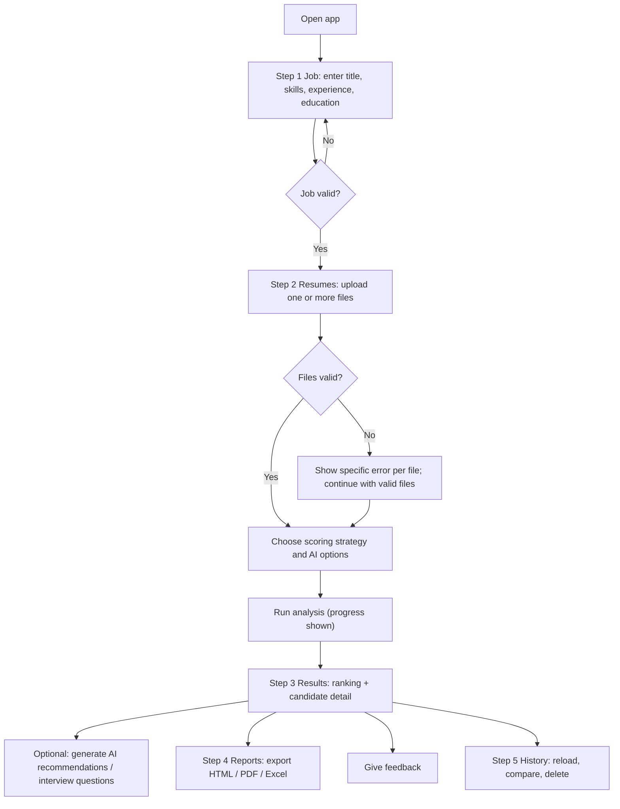

# PROJECT_REQUIREMENTS.md — Functional and Non-Functional Requirements

Related: [README](../README.md) · [SYSTEM_ARCHITECTURE](SYSTEM_ARCHITECTURE.md) · [TECHNICAL_SPECIFICATION](TECHNICAL_SPECIFICATION.md) · [TESTING_STRATEGY](TESTING_STRATEGY.md) · [SUBMISSION_CHECKLIST](SUBMISSION_CHECKLIST.md)

This document is the **authoritative list of requirements**. Every requirement has a stable ID that
is reused in the architecture, plan, tests, and checklist. If another document contradicts this one
on *what* must be built, this document wins (see precedence rule in
[DEVELOPMENT_RULES.md](DEVELOPMENT_RULES.md) §2).

Priority key: **MUST** = required for submission · **SHOULD** = expected unless justified · **COULD** = optional.

---

## 1. Project scope

### 1.1 In scope

- Local Python application (Streamlit UI + CLI) that analyzes resumes against a job.
- Resume formats: **PDF** (text-based), **DOCX**, **TXT**.
- Deterministic parsing, matching, scoring; optional GenAI augmentation through a provider-agnostic interface.
- Reports in HTML, PDF, Excel; JSON persistence; feedback capture; batch processing.
- Logging, central configuration, caching, custom exceptions, validation, automated tests.

### 1.2 Out of scope

| Excluded item | Reason |
|---|---|
| OCR of scanned/image PDFs | Adds heavy dependencies; listed as future work |
| Legacy `.doc`, `.rtf`, `.odt`, images | Unsafe/complex formats; not required |
| User accounts, authentication, multi-tenant hosting | Single-user local tool |
| Automated hiring or rejection decisions | Ethical and legal risk; human review is mandatory |
| Training or fine-tuning ML models | Not needed; GenAI is consumed through APIs |
| Web scraping of job boards or candidate profiles | Privacy/legal risk |
| Cloud deployment, CI/CD | Future improvement |

### 1.3 Assumptions

| ID | Assumption |
|---|---|
| A-01 | Resumes are in English. |
| A-02 | Developers have no paid API subscription; the app must be fully usable with AI off. |
| A-03 | A Gemini free-tier key, a local Ollama install, or an OpenAI-compatible endpoint **may** be available; none is assumed. Free-tier terms and limits change — verify before use. |
| A-04 | Only synthetic or consented resumes are used for development and evaluation. |
| A-05 | The job is described by structured fields (title, skills, experience, education); a free-text description is optional context only. |
| A-06 | Single user, single machine; concurrency needs are modest. |
| A-07 | If the course supplied a starter template containing `TODO` sections, its structure is mapped to the modules in [PROJECT_STRUCTURE.md](PROJECT_STRUCTURE.md); otherwise "all TODO sections completed" is interpreted as *zero `TODO` markers remain in the code base* (verified by the checklist). **Unresolved — see final report.** |

## 2. Users and personas

| Persona | Goal | Key needs |
|---|---|---|
| **Reviewer** (recruiter, hiring manager, instructor) | Shortlist candidates fairly and quickly | Clear scores, matched/missing skills, exports, ability to override |
| **Candidate-advice reader** | Understand gaps and how to close them | Actionable, honest improvement suggestions |
| **Developer / maintainer** | Extend and debug the system | Modularity, logs without PII, tests, docs |

## 3. Functional requirements

| ID | Priority | Requirement | Acceptance criteria |
|---|---|---|---|
| **FR-01** | MUST | **File ingestion & validation.** Accept PDF, DOCX, TXT uploads; validate extension, size, magic bytes, emptiness, encryption, and archive safety before parsing. | AC: Valid files load. Unsupported, oversize, empty, encrypted, corrupt, extension-mismatched, or zip-bomb files raise the specific `FileValidationError` subclass with a user-safe message and are never parsed. |
| **FR-02** | MUST | **Raw text extraction** from PDF (all pages up to limit), DOCX (paragraphs and tables), TXT (encoding fallback). | AC: Known-text fixtures yield expected text; scanned PDFs raise `EmptyResumeError` with an OCR-not-supported message. |
| **FR-03** | MUST | **Text cleaning & normalization** (unicode normalization, whitespace, bullets, hyphenated line breaks, control characters). | AC: Cleaning is idempotent; no resume content is lost other than whitespace/control artefacts. |
| **FR-04** | MUST | **Candidate identity extraction** (name, e-mail) with explicit "not found" handling. | AC: Valid e-mail extracted; malformed/absent e-mail → `None` + `ParseWarning`; name heuristic returns `None` rather than guessing. |
| **FR-05** | MUST | **Skill extraction** using a skills taxonomy with aliases; unknown items from a "Skills" section retained as unrecognized skills. | AC: Skills found in sample resumes match gold annotations (metric M-01); skills not present in the text are never emitted. |
| **FR-06** | MUST | **Experience extraction** (title, company, dates, current flag) and deterministic computation of total years with overlap merging. | AC: Date-range formats listed in TECHNICAL_SPECIFICATION §6.5 parse; overlaps not double counted; no dates → `None` ("unknown"), never `0`. |
| **FR-07** | MUST | **Education extraction** (degree, level, field, institution). | AC: Highest level computed deterministically from the degree-keyword table; unknown → `UNSPECIFIED` + warning. |
| **FR-08** | MUST | **Missing/malformed data handling.** Parser never raises on partial data; it returns what it found plus `ParseWarning`s; it never fabricates data. | AC: A resume with only a name and skills still produces a valid `Candidate`; every field is traceable to resume text. |
| **FR-09** | MUST | **Job requirements input & validation** (title, required skills, minimum experience, education requirement, optional skills, optional description). | AC: Invalid jobs (no title, no required skills, negative experience, oversize lists) raise `DataValidationError` listing every problem. |
| **FR-10** | MUST | **Skill matching** between candidate and job skills using exact, alias, and fuzzy matching; output matched list (with match type and similarity) and missing list. | AC: Typo/alias cases match; confusable pairs (e.g., "Java" vs "JavaScript") do **not** fuzzy-match; each required skill appears exactly once in matched or missing. |
| **FR-11** | MUST | **Experience evaluation** against minimum years, producing a 0–1 sub-score or `unknown`. | AC: Formula in TECHNICAL_SPECIFICATION §7.3 reproduced by tests. |
| **FR-12** | MUST | **Education evaluation** against minimum level (and optional preferred fields). | AC: Formula in §7.4 reproduced by tests. |
| **FR-13** | MUST | **Basic scoring strategy** (required-skill coverage × 100). | AC: Known inputs give documented outputs. |
| **FR-14** | MUST | **Weighted scoring strategy** (configurable weights; unknown/not-applicable dimensions excluded and weights renormalized; coverage reported). | AC: Worked example in §7.5 reproduced; score always within [0, 100]. |
| **FR-15** | MUST | **Strategy switching** through a `ScoringStrategy` interface and registry, selectable via configuration and UI. | AC: Switching strategy changes the result without code changes elsewhere; unknown strategy name raises `UnknownStrategyError`. |
| **FR-16** | MUST | **Fit band / suitability assessment** (`STRONG`, `MODERATE`, `LIMITED`, `LOW`) from configurable thresholds, always accompanied by a human-review notice and caveat flags. | AC: Bands map exactly at thresholds; report never contains "hire"/"reject" verdict language. |
| **FR-17** | MUST | **AI structured extraction (P1)** supplementing rule-based parsing; output validated and grounded in resume text. | AC: Fabricated items are dropped; invalid JSON handled per AI_PROMPTS §3. |
| **FR-18** | MUST | **AI skill categorization (P2)** for skills lacking a taxonomy category. | AC: Every input skill categorized exactly once into the allowed category list or `Other`. |
| **FR-19** | MUST | **AI match explanation (P3)** that explains the deterministic result, citing fact IDs, without altering the score. | AC: AI output cannot change any score field; invalid citations rejected. |
| **FR-20** | SHOULD | **AI improvement recommendations (P4)** for candidate development. | AC: Recommendations reference provided gaps only; no URLs or invented resources. |
| **FR-21** | MUST | **AI interview question generation (P5)** tailored to job and candidate gaps. | AC: 5–12 questions, job-related only, no prohibited topics (age, family, religion, etc.). |
| **FR-22** | MUST | **Provenance labelling** of every reported item (`EXTRACTED_RULE`, `EXTRACTED_AI`, `COMPUTED`, `AI_GENERATED`). | AC: Every report section and every export shows provenance; AI content is visibly marked "AI-generated — not verified". |
| **FR-23** | MUST | **Report generation** containing candidate info, job info, overall score, matched skills, missing skills, experience analysis, education analysis, recommendations, hiring-suitability assessment. | AC: All sections present; sections degrade gracefully when data/AI is absent. |
| **FR-24** | MUST | **HTML export** (self-contained, escaped). | AC: Opens offline; script injection in resume text is rendered inert. |
| **FR-25** | MUST | **PDF export.** | AC: File opens; contains all report sections; Unicode names render. |
| **FR-26** | MUST | **Excel export** (single report and batch ranking workbook). | AC: Sheets/columns as specified; formula-like strings neutralized. |
| **FR-27** | MUST | **Save results** as JSON (atomic writes, schema version) and manage generated reports. | AC: Round-trip load equals saved object; interrupted write never leaves a corrupt file. |
| **FR-28** | MUST | **Load, list, and delete** saved analyses; purge by age. | AC: Listing sorted newest-first; path traversal impossible; corrupt files reported, not crashing. |
| **FR-29** | MUST | **Feedback capture** (rating, per-section thumbs, skill corrections, comment) and a documented review loop that updates prompts/taxonomy under version control. | AC: Feedback appended to JSONL; summary script aggregates; prompt versions are recorded in reports. |
| **FR-30** | MUST | **Batch processing** of multiple resumes with progress indicator, per-file error isolation, and ranked summary. | AC: One bad file never aborts the batch; progress callback reports `done/total`. |
| **FR-31** | MUST | **Streamlit UI** covering job entry, upload, run, results, report export, history, feedback. | AC: Smoke test (Streamlit `AppTest`) passes; flows in §5 work. |
| **FR-32** | MUST | **Graceful AI degradation.** Missing key, provider outage, timeouts, or invalid AI output never prevents deterministic analysis. | AC: With AI disabled/unavailable the full deterministic report is produced; AI sections show status `unavailable`/`disabled`. |

## 4. Non-functional requirements

| ID | Priority | Requirement | Acceptance criteria |
|---|---|---|---|
| **NFR-01** | MUST | **Logging** with INFO, WARNING, ERROR (DEBUG optional) via `logging`; rotating file handler. | Log levels used as defined in TECHNICAL_SPECIFICATION §12; no `print` in library code. |
| **NFR-02** | MUST | **Centralized configuration** in one YAML file validated at startup; env vars for secrets/overrides. | Invalid config fails fast with `ConfigurationError` naming the bad key. |
| **NFR-03** | MUST | **Caching** with `functools.lru_cache` for pure, hashable-argument functions (taxonomy load, normalization, similarity). | `cache_info()` shows hits in tests; no AI responses or resume text cached. |
| **NFR-04** | MUST | **Custom exception hierarchy** rooted at `ResumeAnalyzerError`, each with `error_code` and `user_message`. | All raised errors are from the hierarchy (or wrapped). |
| **NFR-05** | MUST | **Input validation** at every boundary (files, job, config, AI output, storage ids). | Validation tests (UT-VAL, UT-FILE, UT-AI, UT-STORE) pass. |
| **NFR-06** | MUST | **Error handling throughout:** typed exceptions at lower layers; services degrade or isolate; UI shows `user_message`; unexpected errors logged and shown generically. | No unhandled traceback reaches the user in the tested failure scenarios. |
| **NFR-07** | MUST | **Code quality:** PEP 8 (ruff + black, line length 88), type hints on all public functions, docstrings (Google style), meaningful comments. | `ruff check` and `black --check` clean; docstring coverage verified by review/lint rules. |
| **NFR-08** | MUST | **Automated testing:** unit + integration tests; coverage target ≥ 80 % lines for core packages (target, not a result). | `pytest --cov` run recorded in checklist. |
| **NFR-09** | SHOULD | **Performance:** efficient skill indexing (hash lookups, n-gram scan), measured throughput (M-02). | Benchmark procedure executed; results recorded honestly. |
| **NFR-10** | MUST | **Safe file handling:** files treated as data, never executed; size/page/archive limits; no storage of uploads by default. | Security tests UT-FILE-*, UT-SEC-* pass. |
| **NFR-11** | MUST | **Privacy:** no resume text or personal data in logs; PII masked before AI calls; minimal storage. | UT-LOG-*, UT-AI-11 pass. |
| **NFR-12** | MUST | **Secrets management:** API keys only from environment; never in code, config, logs, reports. | UT-SEC-01 secret scan passes. |
| **NFR-13** | MUST | **Prompt-injection resilience:** resume text is untrusted; delimiters with nonces; sanitization; schema-validated outputs; AI never affects scores. | UT-AI-01..03, UT-AI-10, ET-03 pass. |
| **NFR-14** | MUST | **Fairness:** protected/proxy attributes are not extracted, stored, scored, or sent to AI; interview questions avoid prohibited topics. | UT-PARSE-06, UT-AI-12 pass; documented in CONFIGURATION_AND_SECURITY §9. |
| **NFR-15** | MUST | **Explainability & human review:** every score is decomposable; every report carries a human-review notice. | UT-REP-03, UT-SCORE-02 pass. |
| **NFR-16** | SHOULD | **Maintainability:** modular packages with one-directional dependencies; low cyclomatic complexity (M-06). | `radon` and import-rule checks recorded. |
| **NFR-17** | MUST | **Documentation completeness and sync:** README, structure doc, and plan stay aligned with code. | Checklist section "Documentation" complete. |
| **NFR-18** | MUST | **Provider independence:** core logic depends only on `LLMProvider`; no paid API assumed. | App passes full deterministic test-suite with `NullProvider`; a `FakeProvider` is used in tests. |
| **NFR-19** | SHOULD | **Data retention & deletion:** configurable retention; delete-one and purge-by-age operations. | UT-STORE-07, IT-08 pass. |

## 5. User workflows

### 5.1 Primary workflow (single candidate)

### 5.2 Workflow narratives

| Workflow | Steps | Failure handling |
|---|---|---|
| **W-1 Analyze one resume** | Enter job → upload file → Run → read score, matched/missing skills, experience/education analysis → optionally generate AI sections → export | Invalid file → error shown with code; AI failure → section marked unavailable; report still produced |
| **W-2 Batch screen** | Enter job → upload many files → Run (progress bar) → sort ranking → open any candidate → export Excel ranking | Failed files listed in a "Failed" table; successful ones still ranked |
| **W-3 Switch strategy** | Re-run with other strategy → compare scores | Unknown strategy impossible from UI; CLI shows error E-MATCH-001 |
| **W-4 Reload history** | History → choose analysis → view/export/delete | Corrupt file listed as "unreadable" and skipped |
| **W-5 Give feedback** | On result page: rate usefulness, thumbs on sections, correct skills, comment | Feedback write failure shows non-blocking warning |
| **W-6 Purge data** | History → Delete all / older than N days | Confirmation required |

## 6. Input / output specifications

### 6.1 Inputs

| Input | Format | Constraints (defaults; configurable in `config.yaml`) |
|---|---|---|
| Resume file | `.pdf`, `.docx`, `.txt` | ≤ 5 MB; PDF ≤ 20 pages; DOCX uncompressed ≤ 25 MB; extracted text 50 – 100 000 chars; magic bytes must match extension |
| Job title | string | 1–100 chars |
| Required skills | list of strings | 1–50 items; each 1–60 chars; de-duplicated case-insensitively |
| Optional skills | list of strings | 0–50 items |
| Minimum experience | number (years) | 0–50 |
| Education requirement | enum `UNSPECIFIED, HIGH_SCHOOL, DIPLOMA, BACHELOR, MASTER, DOCTORATE` | default `UNSPECIFIED` |
| Preferred fields of study | list of strings | 0–10 items |
| Job description (context) | string | 0–5 000 chars; treated as data in prompts |
| Scoring strategy | `basic` \| `weighted` | default from config |
| AI feature toggles | booleans | defaults in config |

### 6.2 Outputs

| Output | Format | Contents |
|---|---|---|
| `Candidate` | in-memory model / JSON | name, email, skills, experience, education, warnings, provenance |
| `AnalysisReport` | in-memory model / JSON (`data/results/<analysis_id>.json`) | candidate, job, skill matches, score breakdown, fit band, AI insights + status, flags, prompt versions |
| HTML report | `.html` single file | all report sections, provenance badges |
| PDF report | `.pdf` | same content, print-friendly |
| Excel report | `.xlsx` | sheets: Summary, Skills, Experience-Education, AI-Insights (+ Ranking for batch) |
| Feedback record | JSON line in `data/feedback/feedback.jsonl` | analysis id, ratings, corrections, comment |
| Logs | rotating text file | no resume content / PII |

## 7. Constraints

| ID | Constraint |
|---|---|
| C-01 | Python-only back end; no compiled extensions required by the project itself. |
| C-02 | No paid service may be *required* for any MUST requirement. |
| C-03 | No database server; JSON files only. |
| C-04 | No Python code from documentation or resumes may ever be executed (`eval`, `exec`, `pickle.load` on untrusted data are forbidden). |
| C-05 | Scores must be reproducible: same input + same config ⇒ same score. |
| C-06 | AI output may never feed back into scoring, matching, or the extraction of identity data (e-mail). |
| C-07 | Only synthetic or consented data in the repository. |

## 8. Coverage map: original brief → requirement IDs

| Brief section | Covered by |
|---|---|
| 1. Project objective (items 1–12) | FR-01 – FR-32 |
| 2A Data model | FR-04 – FR-09; TECHNICAL_SPECIFICATION §4 |
| 2B Resume parser | FR-01 – FR-08 |
| 2C Matching engine | FR-10 – FR-16 |
| 2D Reporting engine | FR-22, FR-23 |
| 2E File management | FR-01, FR-27, FR-28 |
| 2F Generative AI | FR-17 – FR-22, FR-32, NFR-13 |
| 2G Advanced features | FR-10 (fuzzy), FR-15 (Strategy), FR-24 – FR-26 (exports) |
| 3 Production-ready | NFR-01 – NFR-19 |
| 4 Success metrics | M-01 – M-06 (defined in [TESTING_STRATEGY §9](TESTING_STRATEGY.md)) |
| 5 Final submission | [SUBMISSION_CHECKLIST](SUBMISSION_CHECKLIST.md) and traceability matrix in TESTING_STRATEGY §10 |
| 6 Required documents | The 12 files of this package |
| 8 Technology selection | TECHNICAL_SPECIFICATION §2 |

## 9. Release-gate acceptance criteria

The project is **acceptable for submission** only when **all** hold (each evidenced in [SUBMISSION_CHECKLIST](SUBMISSION_CHECKLIST.md)):

1. Every MUST requirement is implemented and its linked tests pass.
2. A full run on the synthetic sample set produces HTML, PDF, and Excel reports without error.
3. The deterministic pipeline works with AI disabled (`ai.enabled: false`).
4. Prompts P1–P5 have been exercised against at least one real provider *or* a documented local model, and refinements are recorded in the prompt change log.
5. No `TODO`/`FIXME` markers remain; `ruff`, `black --check`, and `bandit` report no unresolved issues.
6. Documentation is synchronized with the code (README, structure, config keys).
7. Metrics M-01 – M-06 have been **measured using the documented procedures** and reported honestly (including unfavourable results).

---
**Document control** — Version 1.0 · Change log: *(none yet)*
