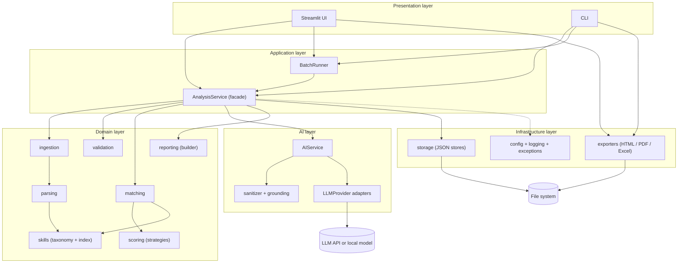
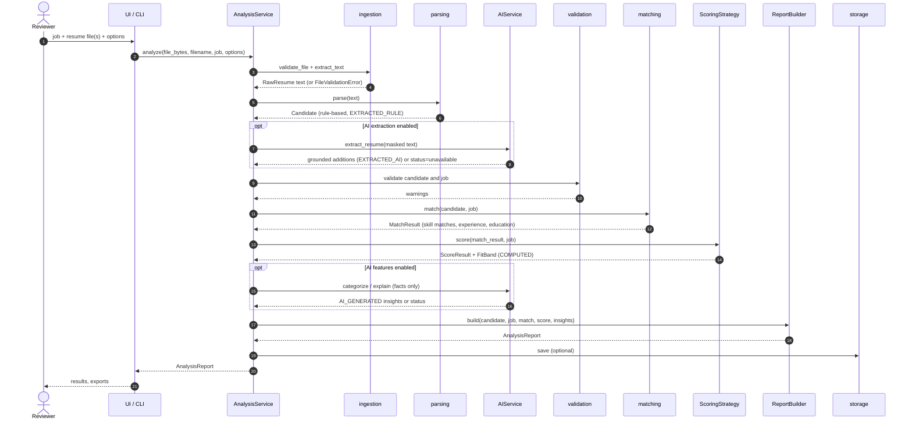
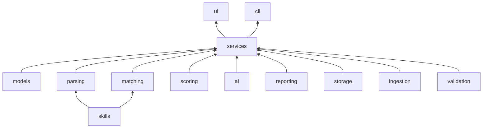
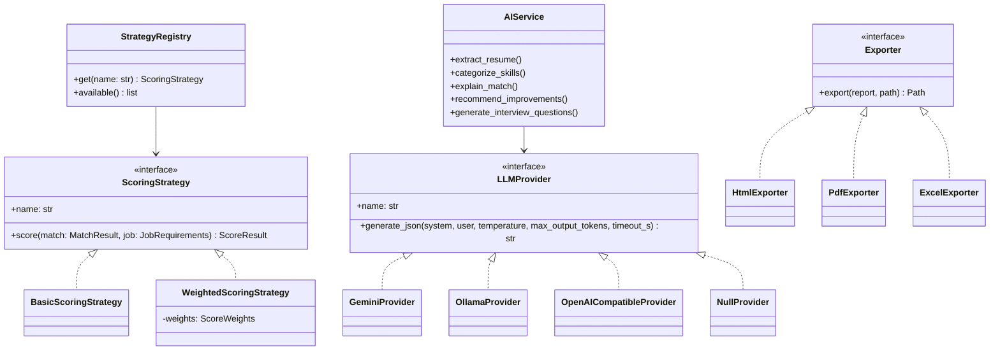
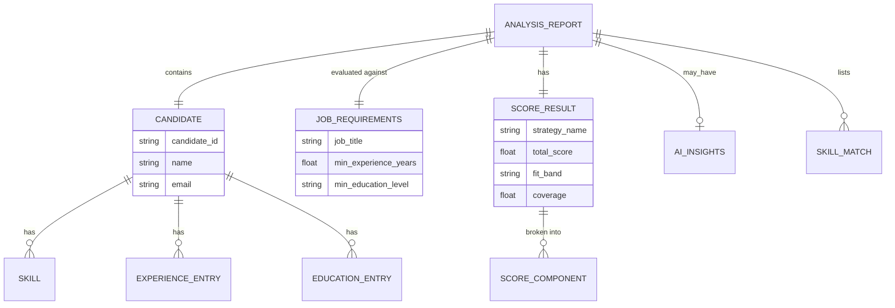
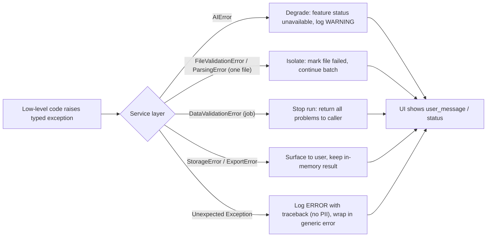
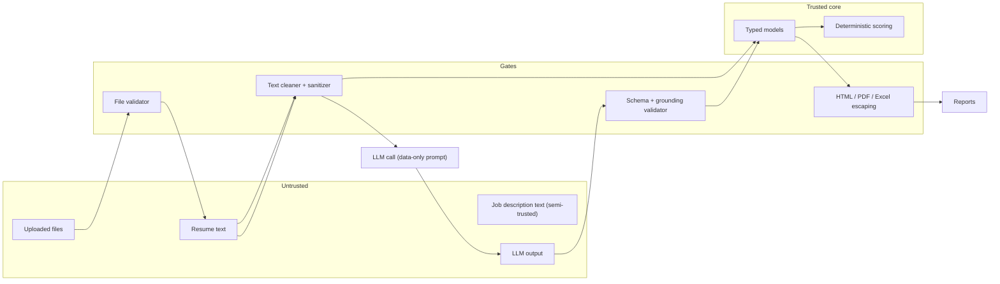

# SYSTEM_ARCHITECTURE.md — Technical Architecture

Related: [PROJECT_REQUIREMENTS](PROJECT_REQUIREMENTS.md) · [TECHNICAL_SPECIFICATION](TECHNICAL_SPECIFICATION.md) · [AI_PROMPTS](AI_PROMPTS.md) · [PROJECT_STRUCTURE](PROJECT_STRUCTURE.md) · [CONFIGURATION_AND_SECURITY](CONFIGURATION_AND_SECURITY.md)

> This is a **design** document. No component described here exists until implemented and verified.

---

## 1. Architectural principles

| # | Principle | Consequence |
|---|---|---|
| P-1 | **Deterministic core, optional AI shell.** Parsing, matching, scoring, and reporting work with no AI. | AI can fail or be disabled without breaking the product (FR-32). |
| P-2 | **AI never decides.** AI output is advisory text; it cannot change scores, bands, or identity fields. | Scores are reproducible (C-05) and explainable (NFR-15). |
| P-3 | **Provenance everywhere.** Every datum carries `EXTRACTED_RULE`, `EXTRACTED_AI`, `COMPUTED`, or `AI_GENERATED`. | Reports separate facts from interpretations (FR-22). |
| P-4 | **Resume content is untrusted input.** | Sanitization, delimiters, validation, escaping on every output path. |
| P-5 | **One-directional dependencies.** Lower layers never import higher layers. | Testable, replaceable modules (NFR-16). |
| P-6 | **Provider independence.** Core depends on an `LLMProvider` protocol only. | NFR-18. |
| P-7 | **Fail soft, isolate, report.** Errors are typed, isolated per file/feature, and surfaced with user-safe messages. | NFR-06, FR-30. |
| P-8 | **Simple over clever.** Plain functions and small classes; patterns only where they pay for themselves. | Beginner-to-intermediate maintainability. |

## 2. Terminology (used consistently across all documents)

| Term | Definition |
|---|---|
| **Candidate** | Structured data parsed from one resume. |
| **JobRequirements** | Structured description of the role being filled. |
| **Skill** | A named competency on a candidate (`Skill` model) with optional canonical name and category. |
| **SkillMatch** | Result of matching one *required/optional* skill to the candidate's skills. |
| **ScoringStrategy** | Pluggable algorithm producing a `ScoreResult` (`basic`, `weighted`). |
| **ScoreResult / ScoreComponent** | Total 0–100 score and its per-dimension breakdown. |
| **Fit band** | `STRONG`, `MODERATE`, `LIMITED`, `LOW` — a presentation of the score, **not** a hiring decision. |
| **AI feature** | One of `extraction` (P1), `categorization` (P2), `explanation` (P3), `recommendations` (P4), `interview_questions` (P5). |
| **AnalysisReport** | The complete, persisted outcome of analyzing one candidate against one job. |
| **Provenance** | Origin label of a datum (see P-3). |
| **Grounding** | Verifying an AI-extracted item actually appears in the resume text. |
| **Degradation** | Continuing with reduced capability (e.g., no AI) instead of failing. |

## 3. High-level architecture

## 4. Component responsibilities

| Component (package) | Responsibility | Must **not** |
|---|---|---|
| `config` | Load and validate `config.yaml`; expose typed `Settings`; apply env overrides | Read secrets into `Settings` (keys are read at provider construction only) |
| `exceptions` | Exception hierarchy with `error_code` and `user_message` | Contain logic |
| `logging_setup` | Configure handlers/formatters; PII-masking filter | Log resume content |
| `models` | Pydantic models and enums (`Candidate`, `JobRequirements`, `ScoreResult`, `AnalysisReport`, …) | Import any other project package |
| `ingestion` | Validate files (extension, size, magic bytes, encryption, archive safety) and extract raw text from PDF/DOCX/TXT | Interpret content |
| `parsing` | Clean text, split sections, extract contact info, skills, experience, education; orchestrate into `Candidate` | Call AI; write files |
| `skills` | Load taxonomy; normalize names; build `SkillIndex` (alias → canonical, n-gram lookup, fuzzy lookup) | Know about candidates or jobs |
| `validation` | Validate `JobRequirements`, `Candidate` quality; produce `ParseWarning`s | Mutate data silently |
| `matching` | Skill matching (exact/alias/fuzzy), experience and education evaluation → `MatchResult` | Compute the final score |
| `scoring` | `ScoringStrategy` interface, `BasicScoringStrategy`, `WeightedScoringStrategy`, registry, fit-band mapping | Use AI output |
| `ai` | Provider adapters, prompt registry, sanitization, grounding, schema validation, `AIService` (5 features) | Alter scores; log prompts/responses |
| `reporting` | Assemble `AnalysisReport`; provenance tagging; export via exporters | Perform analysis |
| `reporting.exporters` | Render HTML, PDF, Excel from an `AnalysisReport` | Re-run analysis |
| `storage` | Atomic JSON persistence, listing, deletion, purge, feedback JSONL | Accept unvalidated ids/paths |
| `services` | `AnalysisService` pipeline facade, `BatchRunner` (progress, isolation) | Contain UI code |
| `ui` | Streamlit pages/components, session state | Contain business logic |
| `cli` | Argument parsing; calls services | Contain business logic |

## 5. Processing pipeline and data flow

### 5.1 Stage contracts

| Stage | Input | Output | Typical failure → handling |
|---|---|---|---|
| 1 Validate file | bytes, filename | validated file descriptor | `FileValidationError` → file rejected, batch continues |
| 2 Extract text | validated file | raw text | `UnreadableFileError`, `EmptyResumeError` → file rejected |
| 3 Clean + parse | raw text | `Candidate` + warnings | never raises on partial data |
| 4 AI extraction (opt.) | masked text | additions to `Candidate` | `AIError` → log WARNING, continue rule-based |
| 5 Validate | candidate, job | warnings | invalid job → `DataValidationError` (stops before any resume work) |
| 6 Match | candidate, job | `MatchResult` | `MatchingError` (bug-level) |
| 7 Score | `MatchResult`, weights | `ScoreResult` | `UnknownStrategyError`, `ConfigurationError` |
| 8 AI insights (opt.) | deterministic facts | `AIInsights` per feature | `AIError` → feature status `unavailable` |
| 9 Build report | all of the above | `AnalysisReport` | — |
| 10 Persist / export | report | JSON / files | `StorageError`, `ExportError` → surfaced; analysis result remains in memory |

## 6. Module interaction rules

Allowed import direction (a package may import only from those listed):

| Package | May import |
|---|---|
| `models`, `exceptions` | stdlib / third-party only (`models` may import `exceptions`) |
| `config`, `logging_setup` | `models`, `exceptions` |
| `skills` | `models`, `exceptions`, `config` |
| `ingestion` | `models`, `exceptions`, `config` |
| `parsing` | `models`, `exceptions`, `config`, `skills` |
| `validation` | `models`, `exceptions`, `config` |
| `matching` | `models`, `exceptions`, `config`, `skills` |
| `scoring` | `models`, `exceptions`, `config` |
| `ai` | `models`, `exceptions`, `config` (and `skills` for category list) |
| `reporting` | `models`, `exceptions`, `config` |
| `storage` | `models`, `exceptions`, `config` |
| `services` | all domain/AI/infra packages |
| `ui`, `cli` | `services`, `reporting`, `storage`, `models`, `config`, `exceptions` |

Enforcement: a unit test (UT-ARCH-01) scans imports and fails on violations.

## 7. Design patterns

| Pattern | Where | Why |
|---|---|---|
| **Strategy** | `ScoringStrategy` (`BasicScoringStrategy`, `WeightedScoringStrategy`) | Switch scoring algorithms without touching callers (FR-15) |
| **Registry / Factory** | `STRATEGY_REGISTRY`, `create_provider(settings)`, `get_exporter(fmt)` | Name-to-implementation lookup from config/UI |
| **Adapter** | `GeminiProvider`, `OllamaProvider`, `OpenAICompatibleProvider` → `LLMProvider` | Isolate vendor SDKs (NFR-18) |
| **Null Object** | `NullProvider` | AI disabled/unavailable without `if` checks everywhere (FR-32) |
| **Facade** | `AnalysisService` | One entry point for UI/CLI |
| **Pipeline** | Stages in §5 | Clear, testable steps |
| **Builder** | `ReportBuilder` | Assemble report from optional parts |
| **Repository** | `ResultStore`, `FeedbackStore` | Hide persistence details |
| **Dependency injection (constructor)** | Services receive settings, index, provider, store | Test with fakes; no globals |
| **Template method (light)** | `Exporter` base defines `export(report, path)` contract | Uniform export API |

## 8. Data model overview

Field-level definitions: [TECHNICAL_SPECIFICATION §4](TECHNICAL_SPECIFICATION.md).

## 9. Provenance model

| Datum | Source stage | Provenance |
|---|---|---|
| Email, name (rules) | contact extractor | `EXTRACTED_RULE` |
| Taxonomy-matched skills; unrecognized skills from the skills section | skill extractor | `EXTRACTED_RULE` |
| Additional skills/experience/education items from P1 that passed grounding | AIService | `EXTRACTED_AI` |
| Total years, highest education level, match type, similarity, credits, score, band | matching/scoring | `COMPUTED` |
| Category of a skill from taxonomy | taxonomy | `EXTRACTED_RULE` (taxonomy-derived) |
| Category of a skill from P2 | AIService | `AI_GENERATED` |
| Explanation, strengths, concerns, recommendations, interview questions | AIService | `AI_GENERATED` |

Rules: provenance is stored on model fields (`provenance` attribute) and rendered as badges in every export. `AI_GENERATED` content is always accompanied by the text "AI-generated interpretation — not verified."

## 10. Error propagation

Exception hierarchy (full table with codes in [TECHNICAL_SPECIFICATION §13](TECHNICAL_SPECIFICATION.md)):

```mermaid
classDiagram
    ResumeAnalyzerError <|-- ConfigurationError
    ResumeAnalyzerError <|-- FileValidationError
    ResumeAnalyzerError <|-- ParsingError
    ResumeAnalyzerError <|-- DataValidationError
    ResumeAnalyzerError <|-- MatchingError
    ResumeAnalyzerError <|-- AIError
    ResumeAnalyzerError <|-- StorageError
    ResumeAnalyzerError <|-- ExportError
    FileValidationError <|-- UnsupportedFileTypeError
    FileValidationError <|-- FileTooLargeError
    FileValidationError <|-- EmptyFileError
    FileValidationError <|-- UnreadableFileError
    FileValidationError <|-- EncryptedFileError
    FileValidationError <|-- FileTypeMismatchError
    FileValidationError <|-- UnsafeArchiveError
    ParsingError <|-- EmptyResumeError
    MatchingError <|-- UnknownStrategyError
    AIError <|-- AIConfigurationError
    AIError <|-- AIProviderError
    AIError <|-- AIResponseError
    AIError <|-- AIBlockedError
    StorageError <|-- ResultNotFoundError
    StorageError <|-- InvalidIdentifierError
    StorageError <|-- CorruptResultError
```

## 11. Security architecture (trust boundaries)

Detailed controls: [CONFIGURATION_AND_SECURITY](CONFIGURATION_AND_SECURITY.md); AI-specific controls: [AI_PROMPTS §2](AI_PROMPTS.md).

## 12. Performance and concurrency design

| Topic | Design |
|---|---|
| Skill indexing | `SkillIndex` built **once** per process: `dict` alias→canonical; set of canonical names; list for fuzzy search. Text scan uses 1–4-token n-gram set lookups: O(tokens × 4). |
| Fuzzy matching | Only for skills that fail exact/alias lookup; length ≥ 4; confusable guard; `rapidfuzz.process.extractOne` with `score_cutoff`; pair results memoized with `lru_cache`. |
| Caching | `lru_cache` on: taxonomy loading, `normalize_skill`, `fuzzy_similarity(a, b)`, settings loading. **Never** cache resume text or AI responses. |
| Batch | Sequential by default (`batch.max_workers: 1`); optional process pool for parsing only (Phase 14). AI calls are throttled by a rate limiter (`ai.requests_per_minute`) and limited concurrency (`ai.concurrency`). |
| Memory | Files processed in memory from bytes; text discarded after parsing unless `storage.store_raw_text: true`. |
| I/O | Atomic writes (temp file + `os.replace`). |

## 13. Architecture decision records (summary)

| ADR | Decision | Alternatives considered | Rationale |
|---|---|---|---|
| ADR-01 | Streamlit UI | Flask/FastAPI + HTML, Gradio, Tkinter | Least code for a capable UI; pure Python |
| ADR-02 | Pydantic v2 for models & AI-output validation | dataclasses + manual validation, `attrs` | One mechanism validates both internal data and AI JSON |
| ADR-03 | `pdfplumber` primary, `pypdf` fallback | PyMuPDF (AGPL license concern), pdfminer.six directly | Good text quality, simple API, permissive license |
| ADR-04 | `rapidfuzz` | `thefuzz`, `difflib` | Faster, actively maintained, MIT |
| ADR-05 | Provider-agnostic `LLMProvider` + `NullProvider` | Hard-wire one SDK | NFR-18, FR-32 |
| ADR-06 | JSON files for persistence | SQLite | Inspectable, simplest; SQLite is the documented upgrade path |
| ADR-07 | YAML config validated by pydantic | JSON config, `.env` only | Comments allowed, readable, typed validation |
| ADR-08 | `reportlab` for PDF | WeasyPrint (system libs), pdfkit (wkhtmltopdf binary) | No system dependencies |
| ADR-09 | Skill extraction by taxonomy lookup, not ML/NER | spaCy NER, embeddings | Transparent, testable, beginner-friendly |
| ADR-10 | AI never influences score | AI-assisted scoring | Reproducibility, fairness, explainability |
| ADR-11 | No raw resume text or uploaded file persisted by default | Persist for convenience | Privacy by default (NFR-11, NFR-19) |
| ADR-12 | Rule-based extraction first, AI as grounded supplement | AI-first extraction | Cheaper, deterministic baseline, injection-resistant |
| ADR-13 | Unknown dimensions are excluded and weights renormalized, with a visible `coverage` value | Treat unknown as 0 | Avoids penalizing missing data silently; coverage keeps it honest |

## 14. Known limitations (design-level)

- Multi-column or graphic-heavy PDFs may extract in scrambled order; DOCX text boxes are not read.
- Rule-based title/company extraction is best-effort; AI extraction can help but is optional.
- Total experience counts calendar time, not relevance of roles.
- The skills taxonomy bounds what can be recognized; unrecognized skills can only be matched fuzzily or exactly by string.
- Scores measure *alignment with stated requirements*, not candidate quality.

---
**Document control** — Version 1.0 · Change log: *(none yet)*
